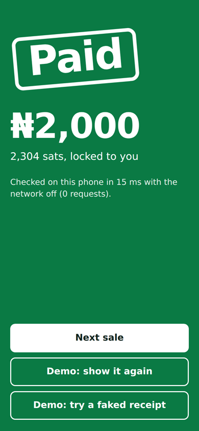
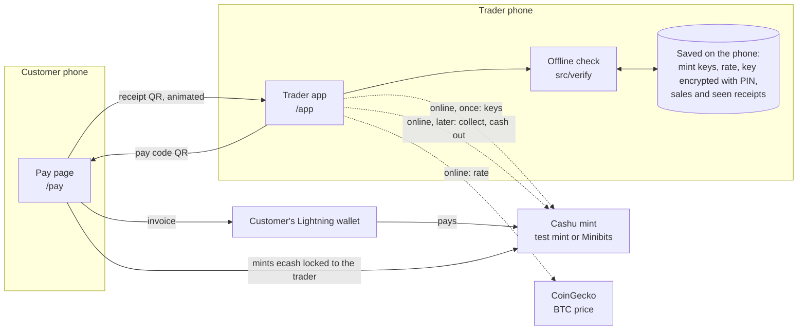
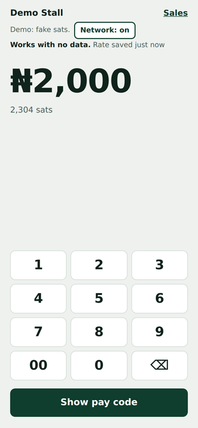
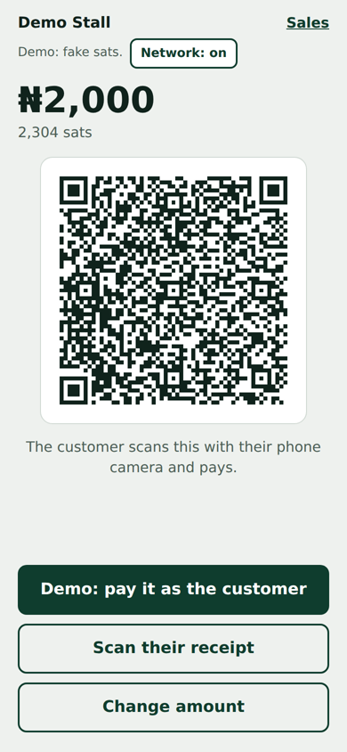
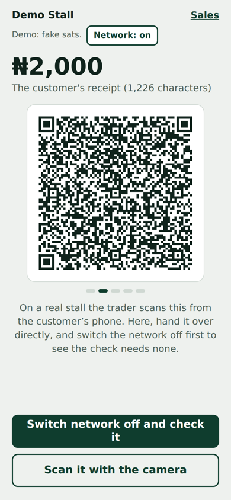
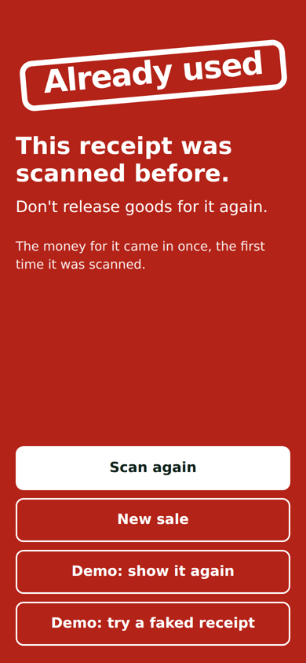
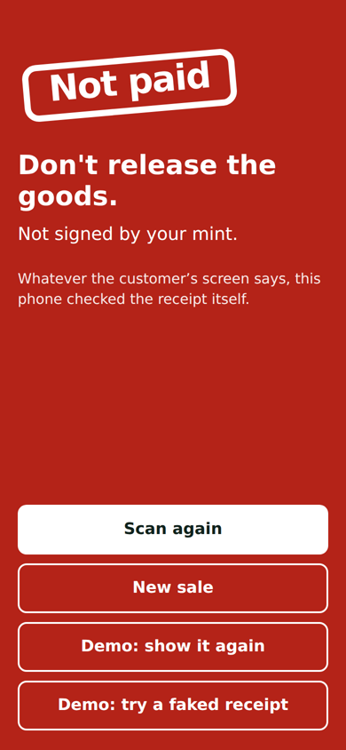
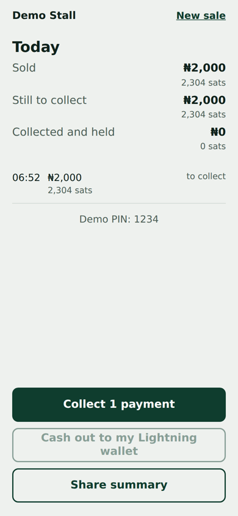
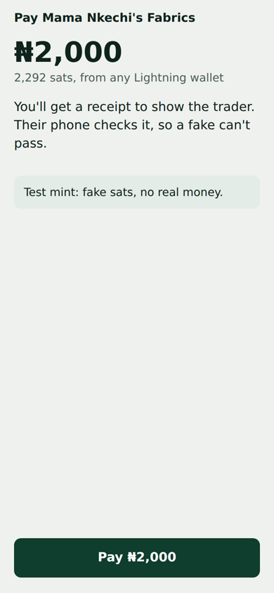

# Sealpay

<p align="center"></p>

**Payments a fake alert can't fake.** Market traders and POS agents in Nigeria lose goods to fake credit alerts and edited transfer screenshots, and on a bad network the real alert comes late anyway. With Sealpay the customer pays from any Lightning wallet and shows a receipt; the trader scans it and their own phone says **Paid** or **Not paid** in under a second, even with no data.

**For judges:** open [sealpay-beta.vercel.app/app#demo](https://sealpay-beta.vercel.app/app#demo) on a phone, type **2000**, tap **Show pay code**, then **Demo: pay it as the customer**, then **Switch network off and check it**. The screen goes green and the phone says "Paid".

- [Try it](#try-it): the live demo on fake sats, no wallet, no signup
- [Proof it's real](#proof-its-real): the real-mint run, the browser run and the numbers, every one with its log
- [Judging criteria](#judging-criteria): where to check each one
- [Built during Dakar Bitcoin Hack 2026](#built-during-dakar-bitcoin-hack-2026): first commit, AI disclosure, libraries
- Film: TBD-post-build: film link

## Try It

You use the real app on the public Cashu **test mint**, which pays its own invoices with fake sats. No wallet, no signup. One phone plays both the trader and the customer.

1. Open **[sealpay-beta.vercel.app/app#demo](https://sealpay-beta.vercel.app/app#demo)**. A **Demo Stall** is set up on fake sats.
2. Type **2000** and tap **Show pay code**. You see ₦2,000, its amount in sats, and the pay code.
3. Tap **Demo: pay it as the customer**. The customer's receipt appears as a QR code.
4. Tap **Switch network off and check it**. A green **Paid** screen, ₦2,000, and "Checked on this phone in … ms with the network off (0 requests)". The phone beeps, buzzes and says it.
5. Tap **Demo: show it again**: red **Already used**. Tap **Demo: try a faked receipt**: red **Not paid**, "Not signed by your mint."

What you just saw: the receipt was checked against the mint's signature and the lock to the trader's key, on the phone, with every request blocked.

With another minute: tap **Sales**, then **Collect 1 payment** with PIN **1234**. The mint confirms the money is real and it's yours. Or tap **Scan their receipt** and scan the QR on a second phone.

<details><summary><strong>One command that checks everything (about 2 minutes, Node 22.18+, internet for the test mint)</strong></summary>

```sh
npm ci
npx playwright install chromium   # once, for the browser check
npm run verify                    # prints PASS or FAIL for each part, then PASS or FAIL
```

It runs the types, 120 tests (with the official Cashu NUT-00 and NUT-12 vectors and fuzzing), the Go/No-Go on the real test mint, the app build against its 60 KB budget, and the judge's demo in a real browser, including opening with no data, slow 3G and the data a payment uses. CI runs the same on every push ([verify.yml](.github/workflows/verify.yml)); its logs and screenshots are on the [`verify-results`](https://github.com/ohjay-official/sealpay/tree/verify-results) branch.

</details>

## Proof It's Real

- **The core claim on a real mint.** The Go/No-Go runs the app's own pay, check, collect and cash-out code on testnut.cashu.space (cdk-mintd 0.18.1): the customer pays, the trader's check is green with the network switched off and makes no request, replays and edits are refused, the mint itself refuses the customer's attempts to take the money back, the trader collects with their signature and cashes 1,000 sats out to a Lightning invoice with 332 sats of change. **21 of 21 steps** ([go-no-go.log](https://github.com/ohjay-official/sealpay/blob/verify-results/go-no-go.log), [script](scripts/go-no-go.ts)).
- **The app in a real browser.** CI taps through the demo above with the site's real security headers: **16 of 16 steps**, Paid checked in 15 ms with the network off and 0 requests ([ui.log](https://github.com/ohjay-official/sealpay/blob/verify-results/ui.log), [screenshots](https://github.com/ohjay-official/sealpay/tree/verify-results/shots)).
- **Low bandwidth, measured** ([metrics.json](https://github.com/ohjay-official/sealpay/blob/verify-results/metrics.json), [sizes.json](https://github.com/ohjay-official/sealpay/blob/verify-results/sizes.json)):

  | What | Measured |
  |---|---|
  | Trader app, first load (gzipped) | 44.0 KB (budget 60 KB) |
  | Trader app on Chrome's Slow 3G, cold start to usable | 2.3 s, 48.5 KB |
  | Customer's whole payment, page included | 46 KB (38.2 KB page, 7.8 KB payment) |
  | Checking a receipt | 0 bytes, about 15 to 80 ms |
  | Opening the app after the first visit | 0 bytes: opens and makes a pay code with no data |

- **Tested hard.** 120 tests: every refusal, parser differential cases, 3,000-run fuzzing of genuine receipts and locks, mutation testing (each rule broken on purpose, 20 of 20 caught), an in-memory mint with real curve math for every money path, and 3,000 random edits to receipts. Two independent reviews and static analysis ([docs/SECURITY.md](docs/SECURITY.md)).
- Real-money run on a mainnet mint: TBD-post-build: two-phone run on Minibits with the steps and amounts.
- Trader visits: TBD-post-build: what 5 traders and POS agents said ([docs/TRADERS.md](docs/TRADERS.md)).

## What's New Here

**Sealpay lets a trader with no data confirm a real Bitcoin payment.** Lightning can't pay a phone that's offline, and every other payment app here asks the trader to trust a screen or wait for the network.

Who has the problem: in a Punch survey of 330 traders in four Lagos markets, 52% had received a fake alert at least once and 27% had lost money to fraudulent digital transactions ([Punch, Feb 15, 2025](https://punchng.com/how-fake-alerts-network-glitches-undermine-digital-trust-in-lagos-markets/)).

- **The receipt is checked on the trader's phone, offline.** Cashu ecash carries the mint's signature proof (NUT-12 DLEQ), so the phone checks it against the mint's keys it saved while online. No network, no server, no alert.
- **The money is locked to the trader** (NUT-11 P2PK). The customer can't take it back or spend it twice; anything with a refund path, a time lock or a second key is refused.
- **The customer needs no Cashu wallet.** They pay a normal Lightning invoice from the wallet they already use; the page turns it into the locked receipt.
- **Built for a ₦60,000 phone at a market stall:** a full-screen green or red verdict with a stamp, a tone, a buzz and the phone's voice ("Paid, 2000 naira"), naira or CFA, English or French, a POS-style keypad, 44 KB to load.
- **Credit where it's due:** [Numo](https://github.com/cashubtc/numo), the Cashu team's point-of-sale app, is the closest product and the mirror image: its customer can be offline but its merchant must be online. Sealpay works when the trader isn't.

## What Works Today

| Piece | State |
|---|---|
| Offline receipt check ([src/verify](src/verify)) | Done; two independent reviews |
| Customer pays from any Lightning wallet ([web/src/pay](web/src/pay), [src/wallet/pay.ts](src/wallet/pay.ts)) | Done on the test mint; lost answers recovered (NUT-09) |
| Trader app: setup, recovery code, PIN, price, pay code, scan, verdict, sales | Done |
| Collect and cash out to a Lightning invoice ([src/wallet/collect.ts](src/wallet/collect.ts)) | Done |
| Opens with no data after the first visit, installs to the home screen | Done |
| French verdicts and spoken result | Done; French not yet reviewed by a native speaker |
| Real money on a mainnet mint (Minibits) | In the app as a setup choice; TBD-post-build: the real-money run |
| Cash out to a Lightning address (instead of pasting an invoice) | Not built |
| NFC sticker on the stall | Not built |
| Per-sale lock keys (better replay protection after restoring a phone) | Not built; see [Constraints](#constraints) |

## Judging Criteria

| Criterion (from the rules) | Where to check it |
|---|---|
| Usefulness & Local Impact | [What's New Here](#whats-new-here), [Metrics to Track](#metrics-to-track), TBD-post-build: trader visits |
| Security by Design | [Security](#security), [docs/SECURITY.md](docs/SECURITY.md), [web/vercel.json](web/vercel.json) |
| UX/UI Quality | [Try It](#try-it), the [screens](#screens), the measured numbers in [Proof It's Real](#proof-its-real) |
| Working MVP | the live demo, `npm run verify`, the [browser run](https://github.com/ohjay-official/sealpay/blob/verify-results/ui.log) |
| Clear Pitch & Docs | this README; TBD-post-build: 3-minute pitch and film |

## Setup

The live app needs nothing: [sealpay-beta.vercel.app](https://sealpay-beta.vercel.app). To run it yourself:

```sh
npm ci
npm run build                # web/src -> web/public/assets, prints sizes
npx serve web/public         # any static server; or deploy web/ to Vercel as is
```

No environment variables, no backend, no database. Seed data: the demo makes its own test stall on fake sats.

## Architecture Diagram



There is no Sealpay server. The site is static files on Vercel; the phones talk to the mint and the price service directly.

## Security

- **What green means:** the receipt was signed by the trader's chosen mint for exactly those amounts (DLEQ against the saved key for each amount), every proof is locked to the trader's key with no way back for the payer, it was not accepted before on this phone, and what lands after the mint's fee covers the price. Signatures are checked before anything else, so a forged receipt is only ever "Not signed by your mint", never a story like "short by 500".
- **Least privilege:** checking needs only the public key; the private key is derived from a 16-byte seed kept encrypted with the PIN (PBKDF2-SHA256, 600,000 rounds, AES-GCM) and is unlocked only to collect or cash out. Collected money stays locked to the trader.
- **Validated inputs:** pay links, receipts (Sealpay's own strict cashuB reader), lock secrets (a narrow JSON parser so the phone and the mint can't read one secret two ways) and every mint answer are checked field by field.
- **Small attack surface:** static site, strict Content Security Policy (scripts from this site only; calls only to the test mint, Minibits and CoinGecko), no third-party scripts, no cookies (CI fails if any response sets one), no analytics.
- **Proven libraries:** [@noble/curves](https://github.com/paulmillr/noble-curves) and [@noble/hashes](https://github.com/paulmillr/noble-hashes) (audited) for all cryptography.
- **How it was reviewed:** functional, adversarial, fuzzing, mutation, real-mint, curve-vector, static analysis (CodeQL, npm audit) and independent-review passes, each with what it found and what was fixed: [docs/SECURITY.md](docs/SECURITY.md).

**What it doesn't promise:** the mint holds the bitcoin until the trader cashes out (custodial ecash), so a mint that fails or cheats can lose that float; Sealpay sweeps to the trader's own wallet and says to keep small amounts there. Offline, it can't know whether the same receipt was accepted on another phone that shares the trader's key.

## Privacy

No accounts, no phone numbers, no personal data collected. The shop name, key, sales and seen receipts stay on the trader's phone. Checking a receipt sends nothing. The mint sees payment requests, as with any Cashu mint, and CoinGecko sees a price request. Details: [privacy page](https://sealpay-beta.vercel.app/privacy).

## Constraints

- **Custodial float:** see What it doesn't promise above.
- **Replay protection lives on the phone:** a phone restored from the recovery code can't tell an old receipt from a new one offline until it has collected. The planned fix is per-sale lock keys.
- **Both phones offline:** if the customer also has no data, they can't pay; the trader's phone is the one that needs none.
- **Mid-range Android first:** scanning uses the phone's built-in QR detector; iPhones load a small backup decoder (47 KB) only when needed.
- **Test mint for the demo:** fake sats, and the public test mint can reset.

## Metrics to Track

From a pilot, per trader: payments checked per week, share checked with no data, fake or reused receipts caught, time from scan to verdict, payments collected within a day, data used per day, and how many traders keep using it after two weeks. Today, measured in CI: 0 bytes and about 15 to 80 ms per check, 46 KB per customer payment, 44 KB first load.

## Next Iteration

1. Pilot with the traders near school; publish the numbers above.
2. Real-money runs on Minibits, then cash out to a Lightning address that pays naira or CFA into a bank or mobile-money account.
3. Per-sale lock keys, and the NFC sticker for tap-to-pay at the stall.
4. Offer the offline check to Cashu upstream: an example or pull request for cashu-ts, and the tests on [CDK issue #1927](https://github.com/cashubtc/cdk/issues/1927) (offline receive).
5. French reviewed by a native speaker; Hausa, Yoruba and Wolof voices.

## Screens

Real screens from the live app, captured by CI on the test mint (fake sats).

<p align="center">







</p>

## Repository

| Path | What's there |
|---|---|
| [src/verify](src/verify) | The offline check: rule layer with no dependencies, curve layer on @noble/curves |
| [src/wallet](src/wallet) | Pay, collect, cash out, keys, PIN lock, pay link, rates, receipt codec, QR frames |
| [src/app](src/app) | The trader's saved sales and seen receipts (IndexedDB) |
| [web](web) | The site and the app: `web/src` (code), `web/public` (pages, styles, icons), `web/vercel.json` (security headers) |
| [scripts](scripts) | Go/No-Go, the one-command check, the build, the browser check, the mint probe |
| [docs](docs) | [Spec](docs/SPEC.md), [research](docs/RESEARCH.md), [security](docs/SECURITY.md), [build log](docs/BUILD_LOG.md), [design](docs/design) |

## Built During Dakar Bitcoin Hack 2026

**A new project: all of it was written during the event, starting Nov 11, 2026.** First commit `c1119e7`, Nov 11, 2026, 14:53 Lagos (13:53 UTC), the plan and research; no earlier code, template or boilerplate. Check it:

```sh
git log --reverse --format='%h %ad %s' --date=iso | head -3
```

- **Day by day:** [docs/BUILD_LOG.md](docs/BUILD_LOG.md). Nov 11: research, plan, the offline check and its Go/No-Go. Nov 15: the money paths. Nov 16: the app, offline use, French, measurements, docs.
- **Written with AI:** the code, tests and docs were written with Claude (Anthropic), directed and reviewed by Oh-Jay (Faithful Adejoh), who made the product decisions, chose the idea after the research, named it, and runs every real-money step and every trader visit.
- **Libraries at the versions the lockfile pins:**
  - App: @noble/curves 2.4.0, @noble/hashes 2.4.0, uqr 0.1.3 (QR codes), jsqr 1.4.0 (QR scanning on iPhones)
  - Development only: @cashu/cashu-ts 4.13.1 (compatibility tests), esbuild 0.28.2, playwright 1.65.1, typescript 6.0.3, @types/node 22.20.5
  - Services: a Cashu mint (testnut.cashu.space for the demo, Minibits for real money), CoinGecko (price), Vercel (hosting), GitHub Actions (CI)
- The live site stays up through judging and at least a week after.

## License

[MIT](LICENSE)
